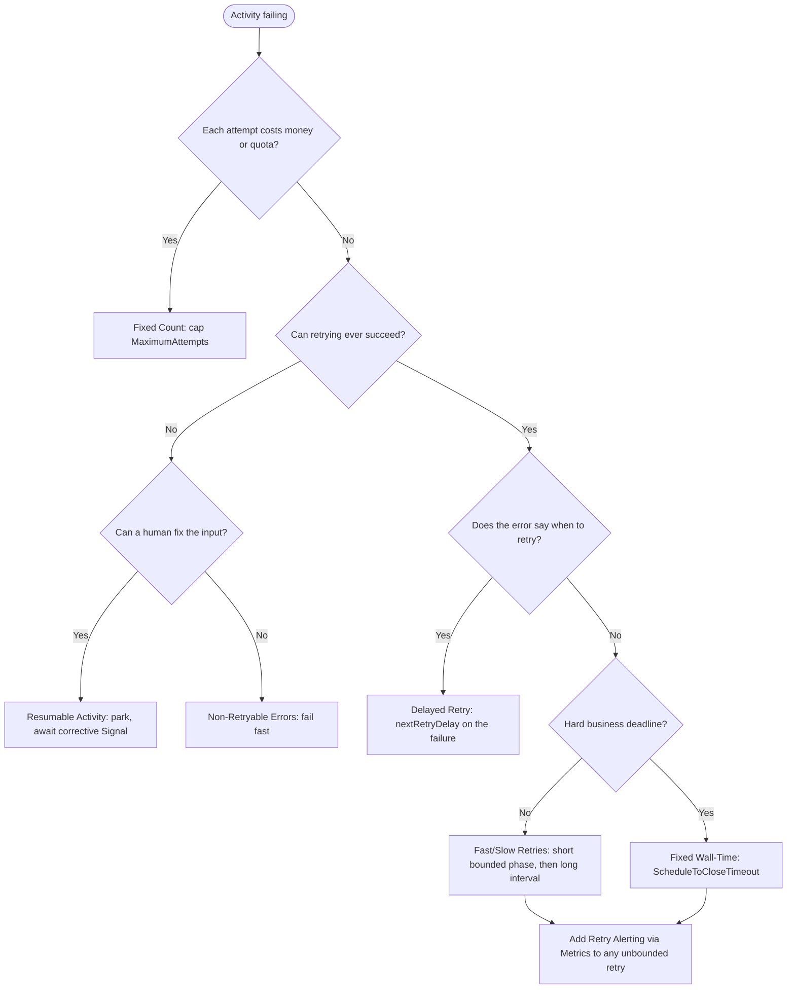

# Temporal Design Patterns: A Solution Architect's Selection Guide

## Purpose and scope

This guide helps you choose and combine Temporal design patterns when you shape a Workflow-based solution. It condenses the catalog at [temporal-sa/temporal-design-patterns](https://github.com/temporal-sa/temporal-design-patterns) (snapshot `66d0678`, 17 July 2026) into decision guidance. It is checked against the published Temporal Cloud limits.

**Audience:** solution architects and senior engineers who design Temporal applications or review customer designs.

**Prerequisites:** you know the Temporal building blocks: Workflows, Activities, Workers, Task Queues, Signals, Queries, Updates, Timers and Child Workflows. You also know that Workflow code must be deterministic.

**In scope:** choosing a pattern, the trade-offs between patterns, platform limits that rule a design in or out, and a design-review checklist.

**Not covered:** per-language implementation steps (each pattern page has code tabs for Java, Go, Python and TypeScript), deciding whether Temporal fits the business at all, running Temporal in production, and Workflow versioning procedures.

---

## 1. Start with the shape of the problem

The catalog sorts its patterns into ten groups. Each group answers one design question. Start with the question that matches your concern, then use the decision rules in section 2.

| Design question | Group | Patterns |
| :--- | :--- | :--- |
| How do I split up and coordinate units of work? | Task Orchestration | Child Workflows, Parallel Execution, Pick First (Race) |
| How do outside callers talk to a running Workflow? | Workflow Messaging | Signal with Start, Request-Response via Updates, Event Accumulator |
| How do I model something that lives for months or years? | Entity & Lifecycle | Entity Workflow, Continue-As-New, Updatable Timer |
| How do I wait on systems, people or time? | External Interaction | Polling, Long Running Activity, Delayed Start, Delayed Callback (Webhooks), Approval |
| How do I keep many services consistent without a shared transaction? | Distributed Transaction | Saga, Early Return |
| How should failures be retried, surfaced or repaired? | Error Handling & Retry | Fixed Count, Fixed Wall-Time, Non-Retryable Errors, Delayed Retry, Fast/Slow Retries, Retry Alerting via Metrics, Resumable Activity |
| How do I process millions of records? | Batch Processing | Fan-Out with Child Workflows, Batch Iterator, Sliding Window, MapReduce Tree |
| How do I protect downstream systems and share capacity? | QoS & Throughput | Downstream Rate Limiting, Priority Task Queues, Fairness |
| How do I cut response time? | Performance & Latency | Local Activities, Early Return + Local Activities, Eager Workflow Start |
| How should Workers be set up and work routed to them? | Worker Configuration | Worker-Specific Task Queues, Activity Dependency Injection |

---

## 2. Decision rules by concern

### 2.1 Composing work

- **Default to an Activity.** Use a Child Workflow only when you need something it provides: its own Workflow ID, its own history limit, the ability to outlive the parent (`ParentClosePolicy.ABANDON`), a different Task Queue, or reuse across several parents.
- **Don't use Child Workflows to organize code or to save cost.** A Child Workflow adds events and actions; Temporal Cloud bills a Child Workflow as two actions.
- **Independent steps:** start them asynchronously and join the results (Parallel Execution). Cap how many run at once. Each pending Activity counts toward the per-execution limit, and an uncapped fan-out can overwhelm the services it calls.
- **Several alternatives where the first answer wins:** use Pick First. Start the alternatives inside a cancellation scope, take the first result, then cancel the scope. The losing Activities must heartbeat to notice the cancellation, and they may already have done partial work.

| Approach | Separate history | Can outlive parent | Overhead |
| :--- | :--- | :--- | :--- |
| Activity | No | No | Low |
| Child Workflow | Yes | Yes (ABANDON) | Medium |
| Separate Workflow + Signals | Yes | Yes | High |

### 2.2 Messaging into Workflows

| You need | Use | Behavior |
| :--- | :--- | :--- |
| To deliver an event whether or not the Workflow exists | **Signal with Start** | Atomically starts the Workflow if needed and delivers the Signal. The sender gets no result back. |
| A validated, typed answer on the same call | **Update** (with an optional validator) | Synchronous. Rejected Updates are not written to history. |
| To read state without changing it | **Query** | Read-only. Never change state in a Query handler. |
| A result straight after the Workflow starts | **Update-with-Start** (see Early Return) | Starts the Workflow and returns the first Update's result in one round trip. |
| To batch a stream of events for one key | **Event Accumulator** | Signal-with-Start into a collector Workflow. It flushes on an inactivity timeout or on an explicit flush Signal. |

Rules that apply to every messaging design:

- Signal and Update handlers are Workflow code. They must be deterministic and idempotent. Track processed operation IDs, because a Signal can be delivered more than once.
- Keep handlers small. A handler should change state and let the main Workflow method react, rather than calling Activities itself.
- Updates cost more than Signals because each one writes to history. A Workflow Execution allows at most 10 in-flight Updates and 2,000 Updates in total.
- Pick a Workflow ID Reuse Policy on purpose. Entity-style Workflows work with `ALLOW_DUPLICATE` or `ALLOW_DUPLICATE_FAILED_ONLY`. One-time operations should use `REJECT_DUPLICATE`.

### 2.3 Long-lived entities

- **Entity Workflow:** one Workflow per business entity, such as an account, device, subscription or cart. Its Workflow ID is the business key, and every state change for that entity goes through it. You get serialized changes, an audit trail in history, and Query-based reads.
- **Not a good fit:** short processes, stateless operations, entities that are only CRUD rows, and entities that receive a high rate of messages. The per-execution message rate is the limit to check (section 3).
- **Continue-As-New is required** for any entity or loop with no natural end. Trigger it when the SDK says it is suggested, or well before the history warning thresholds. Before you call it:
  - wait until all Signal and Update handlers have finished,
  - drain pending Activities,
  - pass state forward as Workflow input,
  - and recompute any remaining timer durations.

  A Child Workflow not started with `ABANDON` is closed when its parent continues as new.
- **Updatable Timer:** a deadline that Signals or Updates can extend, shorten or cancel. Use it for SLAs, grace periods and auction closes. Store the deadline as an absolute time, not a relative duration.

### 2.4 Waiting on the outside world

| Situation | Pattern | Key mechanism |
| :--- | :--- | :--- |
| The external system pushes HTTP callbacks | Delayed Callback, inbound | The webhook handler calls Signal-with-Start using a stable business Workflow ID. |
| Send a callback after a delay (seconds to years) | Delayed Callback, outbound | A durable Workflow timer followed by an Activity. Don't use it for delays under one second. |
| Submit a job and wait for its completion webhook | Delayed Callback, async completion | The Activity stores its task token outside Temporal and returns without completing. The callback handler then completes it with `ActivityCompletionClient`. |
| No callback is offered, and you need results within seconds | Polling, frequent | Loop inside a heartbeating Activity. |
| No callback is offered, and minutes to days is fine | Polling, infrequent | Let the Activity retry policy act as the poll interval (one minute or more). History stays small. |
| A poll sequence whose parameters change | Polling, periodic sequence | A Child Workflow plus Continue-As-New. Don't build a polling loop out of Workflow timers. |
| One task runs for minutes or hours | Long Running Activity | Heartbeat with progress details, use a short heartbeat timeout, and resume from the last heartbeat on retry. |
| A person must decide | Approval | Block on a Signal that carries the decision and its context, with a timer for the fallback path. Use an Update with a validator if the approver's interface needs immediate confirmation. |
| A single run should begin later | Delayed Start | Set the start delay option in Workflow options. No Worker resources are used while it waits. Use Schedules for recurring runs and an Updatable Timer if the delay must change. |

Don't run a listening server, such as an HTTP endpoint or socket, inside an Activity. Run the listener outside Temporal and have it Signal the Workflow, or Signal-with-Start it.

### 2.5 Distributed transactions

- **Saga:** register each compensation *before* you run the step it undoes. When a later step fails, run the compensations in reverse order. Compensations must be idempotent. A Saga gives eventual consistency, so other processes can see intermediate states. Use a local database transaction instead when only one service is involved, and choose another design when an action can't be undone.
- **Early Return:** use Update-with-Start so the caller gets a result after a fast initialization phase (the catalog suggests under 5 seconds) while the slow phase continues in the background. If initialization fails, the Workflow runs its cancel path. The 10-in-flight-Update limit applies.

### 2.6 Retry strategy

Temporal retries Activities indefinitely with exponential backoff by default. The defaults are an initial interval of 1 s, a backoff coefficient of 2.0, and a maximum interval of 100× the initial interval. Choose the strategy that matches each failure mode:

1. If each attempt consumes a paid call or a quota token, cap the number of attempts.
2. If the error is structural, such as bad input, a missing record or a failed authorization, retrying won't help. Park the Workflow for a human to correct the input, or fail fast.
3. If the error says when to try again, for example an HTTP 429 with `Retry-After` or a known maintenance end time, set the next retry delay on that failure only.
4. If the work must succeed or fail within a business SLA, bound the total time across all attempts with `ScheduleToCloseTimeout`.
5. Otherwise, retry quickly for a few attempts and then slowly with no limit, so brief failures and long outages are both handled.
6. Wherever retries are unbounded, emit a metric once the attempt count passes a threshold so on-call staff find out before the SLA is breached.

Every Activity needs a `StartToCloseTimeout` (recommended) or a `ScheduleToCloseTimeout`. Leave `ScheduleToStartTimeout` unset unless the Workflow must react when no Worker is available, as with host-specific queues. Leave Workflow execution and run timeouts at their defaults; use an explicit timer when the business process itself needs a deadline. Setting a Workflow retry policy is generally not recommended.

### 2.7 Batch processing

| Pattern | Record count | Concurrency | Throttles downstream |
| :--- | :--- | :--- | :--- |
| Single Workflow, one Activity per record | Up to a few hundred | Sequential or parallel | No |
| Fan-Out with Child Workflows | Up to about 4M | One child per fixed chunk | No |
| Batch Iterator | Unlimited | One page per run, then Continue-As-New | Yes: a fixed page rate |
| Sliding Window | Unlimited | A bounded window of children; each finishing child Signals the parent to start the next | Yes: set by the window size |
| MapReduce Tree | Unlimited | Recursive, fully parallel tree | No: as fast as possible |

- Pass offsets or references between Workflows, not the records themselves. Temporal is a control plane; bulk data should not flow through it.
- Treat about 1,000 children per parent as a design smell, not a hard limit.
- Use Schedules for recurring batch runs. Pick an overlap policy (the default is Skip), and add jitter when many schedules fire at the same time.
- The CLI's batch operations can Signal, cancel, reset or terminate many Workflows that match a visibility query.

### 2.8 QoS and throughput

| Need | Pattern | Notes |
| :--- | :--- | :--- |
| A downstream service enforces a requests-per-second limit | Downstream Rate Limiting | Send the throttled Activities to a dedicated Task Queue whose Workers set `maxTaskQueueActivitiesPerSecond`, a server-enforced limit for the whole queue. Set the same value on every Worker that polls that queue. |
| Urgent work must not wait behind bulk work | Priority Task Queues | Priority key 1–5, where 1 is highest and 3 is the default. It is set on Workflow, Activity or Child Workflow options, and Activities inherit their Workflow's priority. A steady supply of high-priority work can starve lower levels. |
| Tenants share Workers | Fairness | A fairness key, optionally with a weight, shares dispatch between tenants within a priority level. On Temporal Cloud, Fairness is turned on per Namespace and is a paid feature. |
| Hard isolation | A separate Task Queue and Worker pool per tier or tenant | Static, and idle capacity is not shared. |

Worker concurrency slots (`maxConcurrentActivityExecutionSize` and the related settings) limit how much one Worker runs at once. They are not throughput limits. Without Priority and Fairness, a Task Queue makes no ordering guarantee across Workflow Executions.

### 2.9 Latency

The catalog's benchmark, a three-Activity Workflow on Temporal Cloud, gives approximate figures. Your results will vary with region and load.

| Combination | First response | Total |
| :--- | :--- | :--- |
| Regular Activities | ~850 ms | ~850 ms |
| Early Return | ~265 ms | ~850 ms |
| Local Activities | ~275 ms | ~275 ms |
| Early Return + Local Activities | ~160 ms | ~275 ms |
| Eager Workflow Start + Local Activities (Go, Java, Python) | see note | ~265 ms |

> The catalog gives two different first-response figures for Eager Workflow Start + Local Activities: ~265 ms on the overview page and ~160 ms on the Early Return + Local Activities page. Measure it in your own environment before you commit to a number.

- **Local Activities** suit short (seconds, *including retries*), idempotent work on a path where latency matters. They give up heartbeats, server-side rate limiting and Task Queue routing. A failure re-runs the whole Workflow Task. Prefer regular Activities unless you need this speed.
- **Eager Workflow Start** removes the Matching Service step only when the starter and the Worker share one process and client. Otherwise it falls back to normal dispatch. The TypeScript SDK doesn't support it.
- **When Temporal is a poor fit:** extreme low-latency work where single milliseconds matter, and plain synchronous reads from a database.

### 2.10 Worker configuration

- **Worker-Specific Task Queues:** route a sequence of Activities to the host that ran the first one. Use this for local files, GPUs or elevated access. Set `ScheduleToStartTimeout` so the Workflow can recover if that host dies, and plan cleanup. Go also offers Sessions.
- **Activity Dependency Injection:** create clients and connection pools once per Worker and pass them into Activity implementations. Activities become testable with mocks. Injected dependencies must be thread-safe.
- Run at least two Workers for availability. Every Worker that polls a Task Queue must register the same Workflow and Activity types.

---

## 3. Platform limits that shape designs

These are the Temporal Cloud limits as published at [docs.temporal.io/cloud/limits](https://docs.temporal.io/cloud/limits). Self-hosted defaults may differ.

| Limit | Value | Design consequence |
| :--- | :--- | :--- |
| Event History length | 51,200 events or 50 MB; warns at 10,240 events or 10 MB | Continue-As-New, or split the work across children |
| Incomplete Activities / Signals sent / Child Workflows / external cancel requests | 2,000 of each type per execution; keep under 500 for best performance | Cap fan-out; use the batch patterns |
| Signals received | 10,000 per execution | Entity Workflows must Continue-As-New |
| Updates | 10 in flight, 2,000 in total per execution | Limits Update-heavy and Early Return designs |
| Payload | 2 MB per request; 4 MB per history transaction | Pass references, compress, or use external storage |

**Message rate per Workflow Execution.** Every Signal and Update takes a lock on the execution and writes to history. The catalog's SA guide advises keeping sustained Signal rates to single digits per second for each execution. If one entity will receive more than that, shard it, or batch the messages with an Event Accumulator.

**Timers.** Don't rely on timer accuracy below one second.

---

## 4. Common combinations

| Scenario | Combination |
| :--- | :--- |
| Order checkout with an immediate confirmation | Early Return (Update-with-Start) + Local Activities for validation + Saga for payment and inventory + Non-Retryable Errors for validation failures |
| Customer account or subscription | Entity Workflow + Signal with Start / Updates + Continue-As-New + Updatable Timer for renewals or grace periods |
| Webhook-driven integration | Delayed Callback (Signal-with-Start inbound, async completion for job callbacks) + Delayed Retry for `Retry-After` responses |
| Nightly bulk sync with a rate-limited API | Schedule + Sliding Window or Batch Iterator + Downstream Rate Limiting + Retry Alerting via Metrics |
| Multi-tenant SaaS processing | Fairness (key = tenant) + Priority for interactive work + Activity Dependency Injection |
| Human-in-the-loop exception handling | Resumable Activity or Approval + Updatable Timer for escalation |

---

## 5. Design review checklist

Use this list in a Workflow design session.

1. **Fit:** Is Temporal the control plane here, with bulk data kept out of it? Avoid hard real-time requirements and synchronous read-only lookups.
2. **Determinism:** Is the Workflow code free of I/O, random values, wall-clock time and threads? Are changes tested with the Workflow Replayer?
3. **Workflow ID:** Is it a meaningful business key with an intentional reuse or conflict policy? Never base logic on the Run ID.
4. **History:** Is there a Continue-As-New or partitioning plan for anything that is long-lived or high-volume?
5. **Activities:** Are they idempotent, with idempotency keys? Does each have a deliberate `StartToCloseTimeout` and retry policy? Do long-running ones heartbeat? Are they sized sensibly, not too small and not too broad?
6. **Payloads:** Are payloads small, passed as references, and compressed?
7. **Messaging:** Are handlers idempotent? Are message rates within limits? Is the choice between Signal, Update and Query justified?
8. **Children:** Does each Child Workflow have a real reason to exist? Is the parent close policy reviewed?
9. **Workers:** Are there at least two? Are registrations identical on each Task Queue? Are the Task Queue choices justified (rate limiting, routing, separate deployments)?
10. **Visibility:** Are Search Attributes used for operations only, never for business logic or personal data? Remember they are eventually consistent.
11. **Versioning:** Is there a plan to change code safely: Worker Versioning, or patching with a date to remove the patches?
12. **Observability:** Are there alerts on retry counts and Schedule-To-Start latency?

---

## Related resources

- Pattern catalog source: <https://github.com/temporal-sa/temporal-design-patterns> (`docs/<pattern>.md`)
- Temporal Cloud limits: <https://docs.temporal.io/cloud/limits>
- Task Queue Priority and Fairness: <https://docs.temporal.io/develop/task-queue-priority-fairness>
- Retry policies: <https://docs.temporal.io/encyclopedia/retry-policies>
- Child Workflow versus Activity: <https://docs.temporal.io/encyclopedia/child-workflows>
- Activity timeouts: <https://temporal.io/blog/activity-timeouts>
